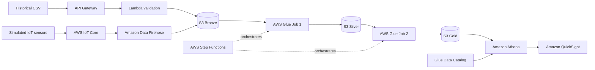

# Arquitectura aprobada

## Estado verificado

| Componente | Estado | Evidencia |
| --- | --- | --- |
| Historical CSV -> API Gateway -> Lambda -> S3 Bronze | IMPLEMENTADO parcialmente | `batch/serverless/functions.yml`, `batch/src/validate_and_store/handler.py` |
| IoT sensors -> IoT Core -> Data Firehose -> S3 Bronze | IMPLEMENTADO en IaC, NOT VERIFIED en AWS | `batch/infrastructure/serverless/iot/iot.yml` |
| Bronze -> Glue Job 1 -> Silver | IMPLEMENTADO en código/IaC, NOT VERIFIED en AWS | `batch/glue/job_bronze_to_silver.py` |
| Silver -> Glue Job 2 -> Gold | IMPLEMENTADO en código/IaC, NOT VERIFIED en AWS | `batch/glue/job_silver_to_gold.py` |
| Step Functions | IMPLEMENTADO en IaC, NOT VERIFIED en AWS | `batch/infrastructure/serverless/data-platform/resources.yml` |
| Glue Data Catalog y Athena | IMPLEMENTADO en IaC, NOT VERIFIED en AWS | `batch/infrastructure/serverless/data-platform/resources.yml` |
| QuickSight | DEFERRED TO FINAL SPRINT | No se añade dashboard de consumo en este sprint |

## Flujos

## Legacy identificado

El repositorio conserva `batch/src/validate_and_persist`, `batch/src/persist_sensor_reading`, las migraciones MongoDB y los stacks SQS/Secrets/SNS. Pertenecen a la arquitectura anterior y no son dependencias del flujo nuevo. No se eliminan automáticamente hasta validar una migración y un plan de retiro de recursos.
