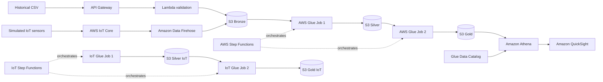

# Arquitectura aprobada

## Estado verificado

| Componente | Estado | Evidencia |
| --- | --- | --- |
| Historical CSV -> API Gateway -> Lambda -> S3 Bronze | IMPLEMENTED local / NOT VERIFIED AWS | `batch/serverless/functions.yml`, `batch/src/validate_and_store/handler.py`, `batch/tests/test_upload_handler.py` |
| IoT sensors -> IoT Core -> Data Firehose -> S3 Bronze | IMPLEMENTED local/IaC / NOT VERIFIED AWS | `streaming/infrastructure/serverless/iot/iot.yml`, `streaming/simulator/simulate_coffee_sensors.py`, `streaming/tests/test_sensor_simulator.py` |
| Bronze -> Glue Job 1 -> Silver | IMPLEMENTED local / NOT VERIFIED AWS | `batch/glue/job_bronze_to_silver.py`, `batch/tests/test_transformations.py` |
| Silver -> Glue Job 2 -> Gold | IMPLEMENTED local / NOT VERIFIED AWS | `batch/glue/job_silver_to_gold.py`, `batch/tests/test_transformations.py` |
| Step Functions histórico e IoT | IMPLEMENTADO en IaC, NOT VERIFIED en AWS | `batch/infrastructure/serverless/data-platform/resources.yml` |
| Glue Data Catalog y Athena | IMPLEMENTADO en IaC, NOT VERIFIED en AWS | `batch/infrastructure/serverless/data-platform/resources.yml` |
| QuickSight | DEFERRED TO FINAL SPRINT | No se añade dashboard de consumo en este sprint |

## Flujos

## Componentes retirados

Los módulos y stacks de MongoDB, SQS, DLQ, Secrets Manager y SNS fueron
eliminados por pertenecer a la arquitectura anterior. No existen como
dependencias del flujo aprobado.
